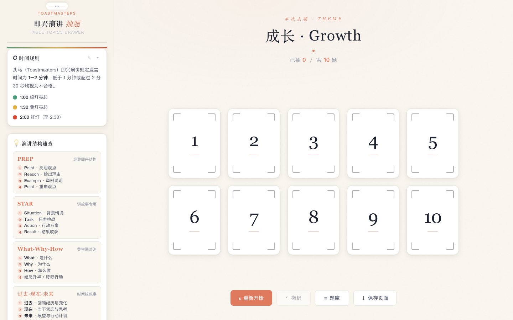
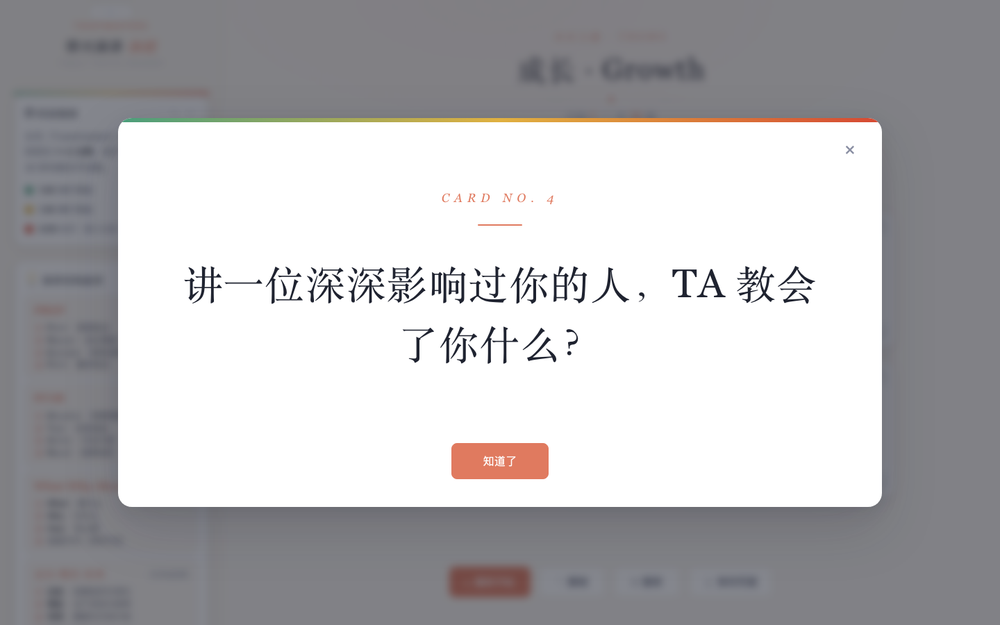
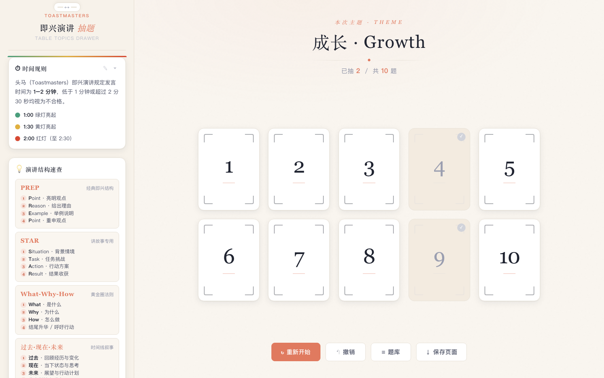
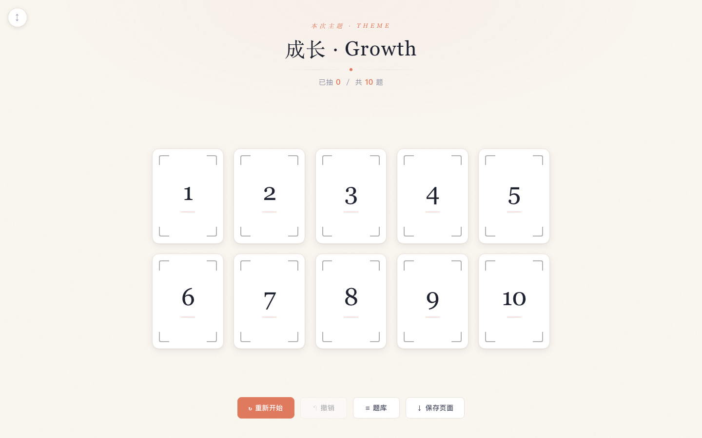
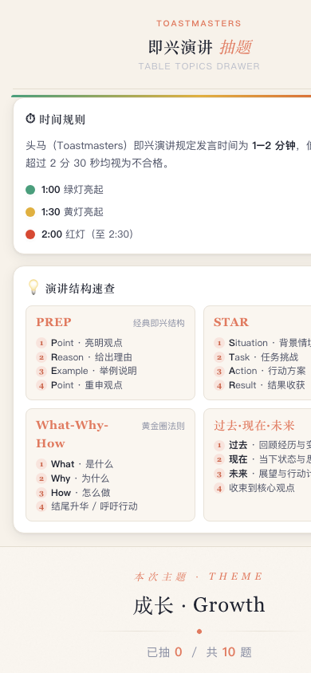

# 即兴演讲抽题器 · Table Topics Drawer

> 为 Toastmasters 俱乐部 Table Topics 环节打造的现场抽题工具 —— **单文件、零依赖、完全离线**。

双击 `index.html` 即可使用：大屏投影抽题、手机辅助阅读皆宜。内置时间规则与四种演讲结构速查，还可一键把「主题 + 题目」导出为离线 HTML 文件，带到任何一台电脑上开场。

## ✨ 功能特性

- 🎴 **现场抽题** — 点击编号卡片即弹出对应题目，卡片变灰标记已抽；灰卡可再次点击查看，误关弹窗也不怕
- 📐 **对称自适应网格** — 卡片区始终居中，按题量自动排成对称行列（10 题 → 5×2，9 题 → 3×3……），卡片与数字大小随展示面积缩放，限制在 80–200px 区间
- 💾 **保存页面** — 一键把当前页面连同主题、题目、规则导出为 `即兴演讲-{主题}.html`，单文件、无需联网，任何带浏览器的电脑都能打开
- ✏️ **题库 / 主题 / 规则自定义** — 每行一题，支持粘贴 CSV 批量导入，可随时恢复默认
- ↩️ **撤销 / 重新开始** — 抽错可撤销，整轮结束一键重开并重新洗牌
- 📖 **演讲助手侧栏** — 时间规则红绿灯说明 + PREP / STAR / What-Why-How / 时间线 四种即兴结构速查；侧栏宽度可拖拽、可折叠
- 📱 **响应式布局** — 桌面 / 平板 / 手机自适应
- 🚫 **零依赖** — 无构建、无 CDN、无框架，兼容 Chrome / Edge / Safari 近两年版本

## 📸 界面截图

<p align="center">
  
</p>

| 题目揭晓 | 已抽灰卡（可再次点击查看） |
| :---: | :---: |
|  |  |

| 侧栏折叠 · 全宽自适应 | 移动端 |
| :---: | :---: |
|  |  |

## 🚀 快速开始

```bash
git clone https://github.com/kevin-meng/impromptu-topic-drawer.git
open impromptu-topic-drawer/index.html   # macOS；Windows 直接双击文件
```

或只下载仓库中的 `index.html` 双击打开 —— 无需安装任何东西，离线可用。

## 🎮 使用说明

| 操作 | 说明 |
| --- | --- |
| 点击卡片 | 弹出对应题目，卡片变灰 |
| 再次点击灰卡 | 重新查看该题目（进度不变） |
| 撤销 | 回退最近一次抽取 |
| 重新开始 | 清空进度并重新洗牌 |
| 题库 | 修改主题与题目（每行一题），支持 CSV，可恢复默认 |
| 保存页面 | 导出含当前主题 / 题目 / 规则的独立离线 HTML 文件 |

所有数据仅保存在本机浏览器 localStorage 中，页面不做任何联网请求。

## 🧩 目录结构

```
impromptu-topic-drawer/
├── index.html          # 全部页面与逻辑（唯一必需文件）
├── screenshots/        # README 截图
├── requirements.md     # 产品需求书
└── README.md
```

## 🛠 技术要点

- **单文件应用**：HTML / CSS / JS 全部内联，直接双击即可运行
- **对称网格算法**：按题量与可用宽度计算最优列数，优先选择可整除的列数保证末行补满；再按可用高度等比收缩卡片宽度（80–200px 硬限制）；`ResizeObserver` 实时响应侧栏拖拽与窗口缩放
- **离线导出**：保存时克隆当前 DOM，将主题 / 题目 / 规则以 JSON 内嵌到 `<script type="application/json">` 中；导出文件使用独立 localStorage 命名空间，与原页面互不干扰
- **状态持久化**：题库 / 主题 / 规则 / 侧栏偏好存于 localStorage；抽取进度有意不持久化，刷新即开始新的一轮

---

仅供交流学习使用，欢迎交流与改进。
